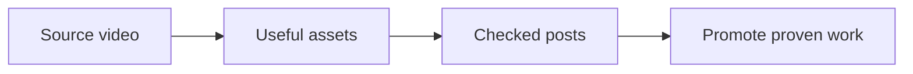

# Fix the Content Factory teaching link

This repair helps you open the guide that shows how one video becomes useful posts and clips. It keeps a bad link from stopping your work. The [Content Factory](https://localservicespotlight.com/content-factory/) explains how each task moves work through Produce, Process, Post and Promote.

## Cause and correction

The old teaching address returned a security block in a normal anonymous request. That does not prove the page was deleted. LSS's maintained Content Factory address returned HTTP 200. Its article explains the four stages, their inputs and outputs, the SEO Tree and where supporting tasks fit. The correction changes the shared teaching destination in 271 guide source files, the maintenance instructions, dashboard and speaker kit: 293 links in 274 files. No site security setting or CMS record was changed.

The body and opening of every changed guide are unchanged. This is one shared-link repair, not 271 rewritten guides or 271 executions. Old review notes remain historical evidence with their original links and dates.

## Exact revision and retained checks

The change manifest in `reviews/content-factory-link-2026-10-13.json` lists every file, its previous and new SHA-256, and substitution count. The before/after comparison confirms that replacing the exact old URL with the checked new URL reproduces every changed source byte. No title, opening, step, example, status, evidence claim or handoff changed.

Existing instruction reviews retain their earlier opening, recipe, evidence and handoff judgments because those source words did not change. The incremental review records each old hash and review date, reads the changed destination, and checks that it supports the same four-stage relationship. It does not certify unrelated links or promote unknown link verdicts. The WordPress guide therefore keeps its remaining link check open. Real execution, article, setup and acceptance gates remain separate.

Exact opening words of this review and the maintenance note: “This repair helps you open the guide that shows how one video becomes useful posts and clips. It keeps a bad link from stopping your work. The Content Factory explains how each task moves work through Produce, Process, Post and Promote.” The linked destination actually names and explains those stages. The body delivers the promise through the source fix, downloaded-guide checks and public readback. This is a meaning check, not just a reading score.

The destination still contains older company wording. Checking it as a useful teaching reference does not certify its entire article against current editorial standards. Its supported edit route must be confirmed before any separate site repair.

## Verification and limits

Build, final-file tests, archive integrity, exact public source and phone/desktop inspection are recorded with this maintenance execution. The initial source commit does not itself establish a live release. The final run record states the observed release result.

## What follows

This repair supports all four stages and their shared prerequisites. Next, use the [Task Library](https://blitzmetrics.com/task-library-dashboard/) to choose a guide with a useful business result. Check existing output and the receiving owner's response before counting success. A prior delivery can supply historical proof while its original recipe or new-user setup remains unknown.
