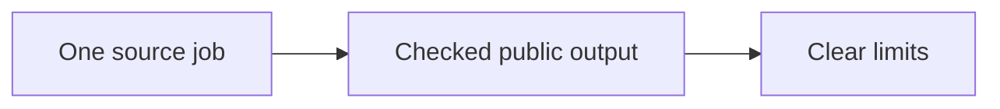

# WordPress publication proof — October 11, 2026

This check shows what a published article can prove. It helps owners see which work was done and which results still need proof. It connects to the [article guidelines](https://localservicespotlight.com/article-guidelines/), which set the checks for a useful page.

## Source and result

The [marketing-agent starter article](https://digimarcon.com/ai-marketing-agent-starter-plan/) and its [three-page PDF](https://digimarcon.com/wp-content/uploads/2026/10/marketing-agents-starter-guide-digimarcon.pdf) support only `step-12-post-article-on-wordpress`. WordPress post 192300 is the stable source identity. The PDF and responsive diagrams belong to that same job.

An independent reviewer opened the live article and PDF. A separate anonymous readback found every approved article passage and link. The PDF and both diagrams matched the reviewed source bytes exactly. The earlier publication receipt records exact saved source and phone/desktop checks. Those source and asset checks remain relevant because the checked content is unchanged. This review does not certify the whole host website.

## Exact output checked

| Output | SHA-256 |
| --- | --- |
| Reviewed article source | `3b1d11ee3563064667bf399b6bfb7887e7d7234a0840cddffd49d68fddb4a458` |
| Public PDF | `c7fc99b9fc7608b9c473e4887306aa0821bea3416704eefa13355402e474c3bc` |
| Desktop diagram | `fa65c3802d26526cf46c84a9a1f4ee16f48d1be7916d2143887eaa70220a5465` |
| Phone diagram | `d8ae62e2a10e799af8c7a3846b18b7a782f8911249e3a5edcbfe63105f2ca6df` |

## What this does and does not prove

Original requester authorization and delivery of the public links were read in the original conversation. Source approval is separate from acceptance of the finished public page. Post-publication receiving acknowledgment, host editorial acceptance, indexing, reader use, setup success and business results remain unknown.

Original recipe version and task start/end times remain unknown. Chat-turn timestamps and the WordPress publication timestamp do not establish them. This is one historical evidence import, with no new execution ID or completed-run increment. Current task writing, setup and accepted-execution gates are unchanged. Repeated notices, PDF delivery and diagrams do not become separate jobs.

## Meaning and next step

The opening above states the action, value and connection in these exact words: “This check shows what a published article can prove. It helps owners see which work was done and which results still need proof. It connects to the article guidelines, which set the checks for a useful page.” The body delivers that promise through checked outputs and explicit limits. The maintained linked article-guidelines destination must be checked before release. This is a judgment of meaning, not a reading-score certification.

This is the Publish stage of the [Content Factory](https://blitzmetrics.com/content-factory/). The existing delivery owner retains any follow-up; no duplicate message or clock is created. Capture the exact recipe, measured result and receiving acknowledgment during the next already-authorized publishing job. See the [Task Library](https://blitzmetrics.com/task-library-dashboard/) and [maintenance record](https://blitzmetrics.com/making-task-guides-easier-to-use/#wordpress-publication-proof-20261011).
