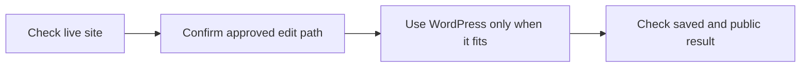

# Check the edit path before using WordPress

This update helps publishers put a page in the right place. It cuts wasted work when a site has changed how it runs. It improves the [WordPress publishing task](https://local-service-spotlight.github.io/task-library/?task=step-12-post-article-on-wordpress#task-step-12-post-article-on-wordpress), which turns a checked draft into a page readers can see.

## Change and exact revision

Task: `step-12-post-article-on-wordpress`. Reviewed recipe SHA-256: `39c70a00cf57820b2ac1a88f6b5b4c677fe2e125c081f696fef74104d724654b`.

Current maintained website guidance requires a positive runtime and edit-source check. The old recipe referred to the supported editor but did not explain how old WordPress HTML, media paths and a login 404 can mislead the publisher. The revised trigger, decision table, first-use prompt, steps, checklist and handoff make that check explicit. Static sites and unknown sources do not enter the WordPress write steps. A retained origin is not automatic edit authority. No production hold or access control is cleared.

## Meaning of the opening

Exact guide words: “Put your checked article on the right live page. Check where the site saves its pages first, so your work reaches readers. Use the article guidelines to check the draft before this step.” The linked [article guidelines](https://localservicespotlight.com/article-guidelines/) supply the draft checks. The body delivers the opening through the runtime decision, correct editor, public readback and receiving handoff.

Exact maintenance-note words: “This update helps publishers put a page in the right place. It cuts wasted work when a site has changed how it runs. It improves the WordPress publishing task, which turns a checked draft into a page readers can see.” Its linked task supplies the corrected recipe. This review checks the meaning and body, not merely a reading score.

## Checks and limits

Independent source review supports the revised opening, recipe, evidence controls and handoff. The Content Factory destination returned HTTP 403 in the web reader and an anonymous request, so the link-availability check remains open. Build, archive and public-release checks are separate stages recorded with this same maintenance attempt. The [maintenance note](https://local-service-spotlight.github.io/task-library/maintenance/wordpress-runtime-routing-2026-10-12.html) describes the cause and correction. Both fictional examples remain labelled. Earlier historical delivery is preserved and does not prove use of this new recipe. No client site was edited, no access requested, no extra historical job imported and no setup or accepted-execution gate promoted.

This supports Post in the [Content Factory](https://blitzmetrics.com/content-factory/). During the next already-authorized publishing job, capture the exact recipe, measured public result and receiving acknowledgment. Setup for a new human remains a separate test. Start from the [Task Library](https://blitzmetrics.com/task-library-dashboard/).

The dashboard introduction also says: “Put your checked article on the right live page. Check where the site saves pages so readers get your work. This follows the draft checks in the article guidelines linked above.” Its existing Reference link opens that maintained guide; the full recipe gives the descriptive inline link.
